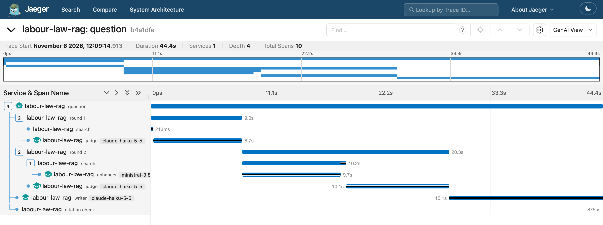
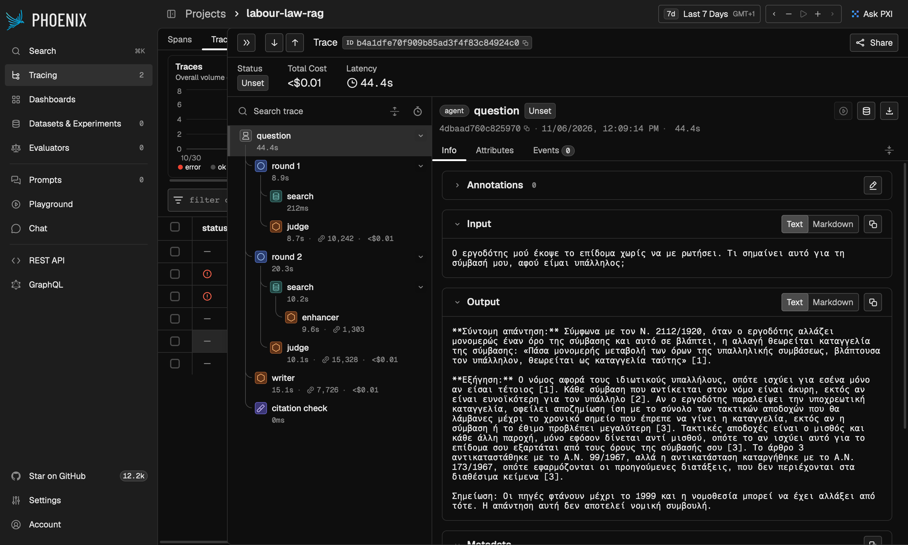

# labour-law-greek-rag

A learning project that answers questions about Greek labour law from 1852 to 1999, using agentic RAG. It searches 1,284 laws, decrees and decisions, asks a judge which passages really apply, searches again if it has to, and writes an answer whose citations are checked in code. It runs on your machine by default, with Ollama and Postgres. Claude Haiku is an optional cloud model, chosen per run.

**This isn't legal advice.** The law texts stop in 1999. Greek labour law has changed a lot since then, and many of these acts were later amended or repealed. Don't use the answers for decisions about a real job or dispute.

## Three ways to run it

| Mode | Command | Complete answers, test / dev | Of all complete answers, with a claim their sources don't support | Wrong refusals | Median time per question, test / dev | Cost per question |
|---|---|---:|---:|---:|---:|---:|
| Local agent | `labour_rag.agent "…"` | 4 of 16 / 12 of 26 | 9 of 16 | 3 of 42 | 118 s / 141 s | none |
| One-shot with Haiku | `labour_rag.ask "…" --haiku` | 10 of 16 / 15 of 26 | 7 of 25 | 4 of 42 | 10 s / 12 s | about $0.002 |
| Agent with Haiku | `labour_rag.agent "…" --haiku` | 10 of 16 / 17 of 26 | 6 of 27 | 0 of 42 | 21 s / 20 s | about $0.004 to $0.005 |

A complete answer has every key fact and none of them wrong, as read by two readers who couldn't see which system wrote it. The columns on unsupported claims and wrong refusals count test and dev together. The local one-shot, `labour_rag.ask "…"`, has 5 of 16 and 9 of 26 complete, at 49 s and 63 s. Times are from one laptop.

For a demo, use the agent with Haiku. It has the most complete answers and no wrong refusals, and costs less than a cent a question. [Why](docs/decisions.md#haiku-as-judge-for-demos).

**With Haiku, your question and the law chunks leave your machine** and go to Anthropic's API. The chunks are public law texts. Without `--haiku`, nothing leaves your machine. Search, embeddings and the Query Enhancer stay local either way.

## Results

Five systems answered the same questions with the same prompts. The dev questions were used while building the local systems. The test questions were kept aside, and each system ran on them once.

- **Haiku doubles the complete answers on test:** 10 of 16 on both Haiku systems, against 5 and 4 on the local ones. Its complete answers also say less that their sources don't support.
- **With Haiku, the agent adds little to complete answers.** It's 10 against 10 on test and 17 against 15 on dev. What it adds is reach, and no wrong refusals where one-shot Haiku has 4.
- **The judge needn't be Haiku for complete answers.** A dev-only test with a local judge and a Haiku writer also gets 17 of 26, so the writer brings the gain. But it's about 4 times slower.

**Don't read too much into this.** Only 16 test questions can be answered, they've been read before, and the readers are Claude models judging a Claude model. [The final report](docs/final-report.md) has the full comparison and what it can't show.

<details>
<summary>All the numbers: five systems, test and dev</summary>

| Test | Baseline | One-shot v2 | Agent | One-shot Haiku | Agent Haiku |
|---|---:|---:|---:|---:|---:|
| **Complete answers, read by hand** | **5 of 16** | **5 of 16** | **4 of 16** | **10 of 16** | **10 of 16** |
| Of those, with a claim their sources don't support | 5 | 5 | 2 | 2 | 3 |
| Complete by the matcher alone | 7 of 16 | 6 of 16 | 5 of 16 | 11 of 16 | 11 of 16 |
| Key facts found | 60% | 69% | 66% | 85% | 88% |
| Correct refusals | 2 of 4 | 1 of 4 | 3 of 4 | 4 of 4 | 4 of 4 |
| Wrong refusals | 2 of 16 | 1 of 16 | 2 of 16 | 1 of 16 | 0 of 16 |
| Right chunk reached the Writer | 12 of 17 | 15 of 17 | 14 of 17 | 15 of 17 | 16 of 17 |
| Time per question (median) | 54 s | 49 s | 118 s | 10 s | 21 s |
| Time for the whole run | 19 min | 17 min | 52 min | 3 min | 8 min |
| Cost of the whole run | $0.00 | $0.00 | $0.00 | $0.04 | $0.09 |
| Failures: search | 5 | 1 | 0 | 1 | 0 |
| Failures: Judge | - | - | 3 | - | 0 |
| Failures: Writer | 8 | 13 | 10 | 5 | 6 |
| Failures: all | 13 | 14 | 13 | 6 | 6 |

| Dev | Baseline | One-shot v2 | Agent | One-shot Haiku | Agent Haiku |
|---|---:|---:|---:|---:|---:|
| **Complete answers, read by hand** | **6 of 26** | **9 of 26** | **12 of 26** | **15 of 26** | **17 of 26** |
| Of those, with a claim their sources don't support | 6 | 6 | 7 | 5 | 3 |
| Complete by the matcher alone | 9 of 26 | 12 of 26 | 16 of 26 | 16 of 26 | 18 of 26 |
| Key facts found | 51% | 68% | 78% | 78% | 85% |
| Correct refusals | 4 of 6 | 4 of 6 | 5 of 6 | 5 of 6 | 5 of 6 |
| Wrong refusals | 2 of 26 | 0 of 26 | 1 of 26 | 3 of 26 | 0 of 26 |
| Right chunk reached the Writer | 13 of 27 | 22 of 27 | 24 of 27 | 22 of 27 | 25 of 27 |
| Time per question (median) | 36 s | 63 s | 141 s | 12 s | 20 s |
| Time for the whole run | 20 min | 33 min | 94 min | 6 min | 11 min |
| Cost of the whole run | $0.00 | $0.00 | $0.00 | $0.08 | $0.13 |
| Failures: search | 13 | 4 | 2 | 4 | 1 |
| Failures: Judge | - | - | 1 | - | 1 |
| Failures: Writer | 9 | 15 | 12 | 8 | 8 |
| Failures: all | 22 | 19 | 15 | 12 | 10 |

The baseline is the Phase 2 system. One-shot v2 is the same steps with better search. The agent searches, judges and takes up to 3 rounds.

</details>

## How it works

```
BUILD THE INDEX (once)

  greek_legal_code, volume 41
        |
        v
  clean, chunk by article, add a header to each chunk
        |
        v
  embed with Ollama, store in Postgres + pgvector


ANSWER A QUESTION

  question
        |
        v
  search the plain question
        |
        v
  judge: which chunks fit, and what next? <-----------------+
        |   search again, at most 3 rounds in all:          |
        |     further down the list (round 2 only),         |
        |     rewriter, laws it named, next articles -------+
        |   refuse: the code says so, and names the law if known
        |   answer: go on, also if the judge wants more but
        |     an approved chunk answers directly
        v
  answer from approved chunks, with citations
        |
        v
  citation check
```

The one-shot (`labour_rag.ask`) skips the judge: it searches once and answers. To follow one question from start to finish, with every rule and a real example, read [How a question is answered](docs/how-a-question-is-answered.md).

## How to run it

You need Python 3.11, curl, about 11 GB of free disk space, most of it the three models, [Docker Desktop](https://www.docker.com/products/docker-desktop/) and [Ollama](https://ollama.com). Run these from the repository root:

```bash
# 1. Packages
python3 -m venv .venv
.venv/bin/pip install -r requirements.txt

# 2. The dataset, about 440 MB
base=https://huggingface.co/datasets/AI-team-UoA/greek_legal_code/resolve/main
for c in volume chapter subject; do
  mkdir -p data/raw/greek_legal_code/$c
  for s in train validation test; do
    curl -sSL --fail -o data/raw/greek_legal_code/$c/$s.parquet "$base/$c/$s-00000-of-00001.parquet"
  done
done

# 3. Clean and chunk it, in a few seconds
.venv/bin/python -I scripts/build_chunks.py

# 4. The database. Set POSTGRES_PASSWORD in .env after copying it
cp .env.example .env
docker compose up -d

# 5. The models and the embeddings. The last line takes about 2.5 hours, and you can stop it and start it again
ollama pull bge-m3
ollama pull qwen3-embedding:4b
ollama pull ministral-3:8b
.venv/bin/python -m labour_rag.load
.venv/bin/python -m labour_rag.embeddings

# 6. Ask
.venv/bin/python -m labour_rag.ask "Πόσες ημέρες κανονική άδεια δικαιούται ο μισθωτός;"
.venv/bin/python -m labour_rag.agent "Πόσες ημέρες κανονική άδεια δικαιούται ο μισθωτός;" --trace
```

To skip the long embedding step, leave out `labour_rag.embeddings` and add `--embedding bge-m3` to `ask` or `agent`.

**With Haiku:** put your key in `.env` as `ANTHROPIC_API_KEY` and add `--haiku`. The key is checked before any search, at no cost. The command says at the start what leaves your machine, and at the end what the question cost.

**Tests:** `.venv/bin/python -m unittest discover -s tests -t .`

[Setup, commands and layout](docs/setup.md) has every step, the everyday commands, how to measure, and what each file is for.

## Seeing what a question did

With tracing on, every question becomes a trace: a tree of timed steps you can open in a viewer. It shows where the time, the tokens and the money went, and why the agent searched again. Tracing is off by default, and the viewers start only when you ask. The same trace goes to Jaeger and Phoenix, over OTLP, OpenTelemetry's standard protocol.





```bash
docker compose --profile observability up -d     # start the viewers: about 370 MB to download, about 500 MB of memory
# add TRACING=on to .env
.venv/bin/python -m labour_rag.traced agent "Πόσες μέρες άδεια δικαιούμαι;" --trace
```

It prints the answer as usual, then a link to the trace in each viewer. If the viewers aren't running, you still get the answer, with one warning. The plain commands, such as `python -m labour_rag.agent`, never trace, on purpose: they run only the frozen code that was measured.

**Prompts and chunks are recorded in the traces, on your machine.** That's fine here because they're public law texts. In a company setting you'd leave them out by default. The API key and the contents of `.env` are never recorded. [Observability](docs/observability.md) says what to look at and which questions it answers.

## Limitations

- **Old law only.** The newest text is from 1999, and expected answers follow this data, not today's law.
- **Laws are missing.** The chunks mention 700 laws and decrees that aren't documents in our data, among them Ν. 435/1976 on overtime pay, and 468 documents hold only a title. [The list](docs/missing-laws.md).
- **Volume 41 only.** Related rules in other volumes are left out, such as seafarers' contracts, unemployment benefits and civil servants.
- **Messy text.** It comes from a printed collection: no line breaks, page headers in mid-sentence, and only 445 of the 1,284 documents divided into articles. [Details](docs/data-exploration.md).
- **Few test questions, and no human reader.** Only 16 test questions can be answered, so only a large gap between systems means much. Those questions have been read before. The readers are Claude models, and Haiku is one too.
- **A complete answer isn't always a safe one.** 17 of the 34 test answers that pass a hand read still say something else their source doesn't support. Check the source.
- **The judge and the writer can be wrong.** The judge can reject the right chunk or approve a wrong one, and the writer can misread what it was given. The local agent takes about 2 minutes a question, most of it the judge.
- **Haiku doesn't tell υπερεργασία from υπερωρία,** and neither does the local model. Haiku's runs also aren't exactly repeatable: it takes no temperature or seed.

## Read more

| | |
|---|---|
| [Decisions](docs/decisions.md) | Every architecture decision: why, the evidence and the alternatives |
| [Lessons learned](docs/lessons-learned.md) | What this project taught, technical and process |
| [Backlog](docs/backlog.md) | Open questions and future work, in one list |
| [Final report](docs/final-report.md) | All the systems side by side, and how little this can show |
| [How a question is answered](docs/how-a-question-is-answered.md) | Every rule in plain words, with one question traced |
| [Models](docs/models.md) | Which model does what, and what it costs |
| [Observability](docs/observability.md) | Traces: what to look at, and which questions they answer |
| [Setup, commands and layout](docs/setup.md) | Every step, every command, every file |
| [Code tour](docs/code-tour.md) | The code, for people who don't read Python |
| [Project journal](docs/project-journal.md) | Phase by phase, as it happened |

This was built with Claude Code. In the reports, "I" is Claude Code and "the owner" is the person who ran the project. In the journal, "I" is the owner.

## Status

- [x] Phase 0: explore the data. [Report](docs/data-exploration.md).
- [x] Phase 1A: clean and chunk. [Report](docs/chunking-report.md).
- [x] Phase 1B: Postgres + pgvector in Docker, embeddings, semantic and accent-insensitive keyword search. [Report](docs/search-report.md).
- [x] Phase 1C: one-shot baseline, with citations checked in code. [Report](docs/answer-report.md).
- [x] Phase 2: evaluation set of 52 questions, and metrics. [Report](docs/eval-report.md).
- [x] Phase 3A: fix the fusion step. [Report](docs/retrieval-report.md).
- [x] Phase 3B: Query Enhancer, qwen3 as the default embedding, repeat filter fixed. [Report](docs/enhancer-report.md).
- [x] Phase 3C: the agent loop with LangGraph. [Report](docs/agent-report.md).
- [x] Phase 3C.1: two fixes, then the agent is frozen. [Report](docs/agent-report.md).
- [x] Phase 4A: final test runs, compared with the baseline. [Report](docs/final-report.md).
- [x] Phase 4B: Claude Haiku as judge and writer, with a budget guard. [Report](docs/final-report.md).
- [x] Phase 4B.1: `--haiku` for demos, a key check, and `agent-mixed` as a dev-only test. [Report](docs/final-report.md#does-the-judge-need-to-be-haiku).
- [x] Phase 5: observability with OpenTelemetry. [Guide](docs/observability.md).
- [x] Wrap-up: decisions, lessons, backlog, and a check for publishing.
- [ ] Phase 6 (later): a modern layer with Π.Δ. 80/2022, labelled by period. See the [backlog](docs/backlog.md).

## Data and credits

**Dataset.** The law texts come from the Greek Legal Code (GLC) dataset, [AI-team-UoA/greek_legal_code](https://huggingface.co/datasets/AI-team-UoA/greek_legal_code) on Hugging Face. Papaloukas et al. built it from the "Permanent Greek Legislation Code - Raptarchis" catalogue. It keeps its own licence, [CC BY 4.0](https://creativecommons.org/licenses/by/4.0/).

The full dataset isn't in this repository: you download it in step 2. Excerpts of the law texts are, in `docs/` and `eval/`, under that same licence. Our cleaning and chunking change the original text, and [the chunking report](docs/chunking-report.md) documents how.

> Christos Papaloukas, Ilias Chalkidis, Konstantinos Athinaios, Despina-Athanasia Pantazi and Manolis Koubarakis. *Multi-granular Legal Topic Classification on Greek Legislation.* Proceedings of the Natural Legal Language Processing Workshop 2021. <https://arxiv.org/abs/2109.15298>

**Code.** MIT, see [LICENSE](LICENSE). It covers only the code.

**Inspiration.** [TeoMastro/GreekLegislationRag](https://github.com/TeoMastro/GreekLegislationRag) (GPLv3) gave us the idea. No code was copied from it.
