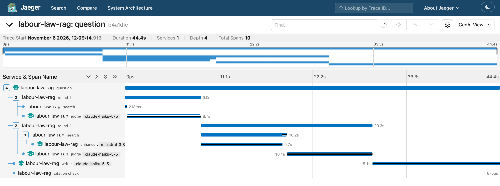
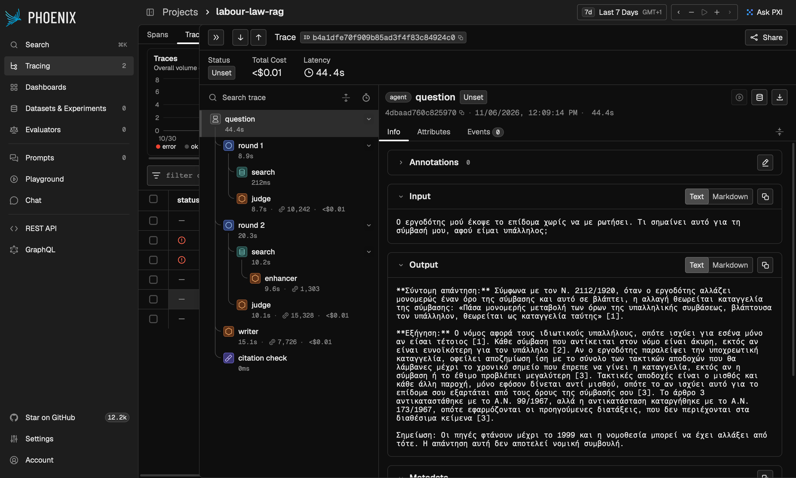

# Observability: seeing what a question did

With tracing on, every question becomes a **trace**: a tree of timed steps, called **spans**, one for each thing the system did. You can open it in a viewer and see where the time, the tokens and the money went, and why the agent searched again.

This is for learning and for demos, not for measuring. Tracing is off by default, the viewers start only when you ask, and the code that answers a question doesn't change.

| Jaeger: where the time went | Phoenix: what each step read and wrote |
|---|---|
|  |  |

Both pictures show the same trace, of one question through `agent --haiku`.

## How to start

```bash
# 1. Start the viewers. The first time, this downloads about 370 MB.
docker compose --profile observability up -d

# 2. Add this line to .env
TRACING=on

# 3. Ask through labour_rag.traced. Everything after the command name goes to that command.
.venv/bin/python -m labour_rag.traced agent "Πόσες μέρες άδεια δικαιούμαι;" --trace
.venv/bin/python -m labour_rag.traced agent "Πόσες μέρες άδεια δικαιούμαι;" --haiku
.venv/bin/python -m labour_rag.traced ask "Πόσες μέρες άδεια δικαιούμαι;"
.venv/bin/python -m labour_rag.traced evaluate --split dev --system agent-haiku
```

Each command prints its answer as usual, then a link to its trace in each viewer.

To stop the viewers, keeping the database running:

```bash
docker compose --profile observability stop jaeger phoenix
```

`docker compose up -d` without the profile still starts only the database.

**The plain commands never trace,** whatever `.env` says, on purpose. `python -m labour_rag.agent` runs only frozen code, so no new code gets a chance to load. Tracing goes through `labour_rag.traced`, which wraps the same commands.

| Viewer | Page | Licence | Download | On disk | Memory |
|---|---|---|---:|---:|---:|
| Jaeger 2.22.0 | <http://127.0.0.1:16686> | Apache-2.0 | 51 MB | 164 MB | about 40 MB |
| Phoenix 21.0.0 | <http://127.0.0.1:6006> | Elastic License 2.0 | 323 MB | 1.4 GB | about 450 MB |

Both licences allow free local use. The Elastic License only forbids offering Phoenix to others as a hosted service.

## What's in a trace

This is the local agent on a question that searches again, from a real run:

```
question                191.5 s   local, answered, 2 rounds, $0
├─ round 1               48.9 s   the Judge said search_again, so it did
│  ├─ search              0.8 s   8 chunks kept
│  └─ judge              48.2 s   ministral-3:8b, 5,097 tokens in, 708 out
├─ round 2               89.5 s   the Judge said search_again, the code's stop rule answered instead
│  ├─ search             10.9 s   13 chunks kept
│  │  └─ enhancer        10.5 s   ministral-3:8b, 1,115 tokens in, 188 out
│  └─ judge              78.7 s   ministral-3:8b, 8,100 tokens in, 1,069 out
├─ writer                52.9 s   ministral-3:8b, 5,479 tokens in, 630 out
└─ citation check         0.0 s   0 of 2 quotes found
```

The same question through `agent --haiku` took 44.4 s and cost $0.0065, and its Judge answered by itself in round 2. The one-shot has no rounds: its trace is `question`, `search`, `writer` and `citation check`.

| Span | What it records |
|---|---|
| `question` | The question, the system (local, haiku or mixed), the final decision, total time and total cost |
| `round n` | What the Judge said, what happened next, what it said was missing, and whether the code's stop rule overruled it |
| `search` | What was searched, how many candidates, and the chunks kept, with law, article, rank and text |
| `judge` | Model, tokens in and out, cost, the verdict on each chunk, the decision and "missing" |
| `enhancer` | Model, tokens, and the search phrases it wrote |
| `writer` | Model, tokens, cost and the answer |
| `citation check` | Quotes found out of the total, citations used, and any failures |

An evaluate run makes one trace per question, tagged with the run's name.

## Which questions it answers

- **Where does the time go?** Open the trace in Jaeger and read the bars. In the local trace above, the Judge takes 66% of the time. In Haiku's, its largest single step is the writer at 15.1 s, and 9.7 s goes to the local Enhancer.
- **Where do the tokens and the money go?** Click a `judge` or `writer` span. Haiku's Judge cost $0.0042 across two rounds and its writer $0.0023. The total is on the `question` span.
- **Why did the agent search again?** Click `round 1` and read `labour.round.judge_said` and `labour.round.missing`. The second is the Judge's own sentence on what it couldn't find.
- **Did the code overrule the Judge?** On `round 2` of the local trace, `labour.round.judge_said` is `search_again`, `labour.round.next_step` is `answer` and `labour.round.stopped_by_code` is true.
- **Which chunks did the Judge reject, and why?** Click `judge` and read `labour.judge.verdicts`, one line per chunk.
- **What did the Writer actually read?** In Phoenix, click `writer` for the messages, or `search` for the retrieved documents.
- **Why was this question refused?** The `question` span says `refused by the Judge`, and there's no `writer` span.
- **What broke?** A failed step is marked ERROR, with the message. A rejected key gives a `question` span with `Anthropic's API rejected ANTHROPIC_API_KEY...`. With Ollama down, `search` and `question` both say `cannot reach Ollama`.
- **Is it the model or the machine?** In one demo run, the Judge's span took 1,974 s where the same question takes about 30 s. Its tokens were the same as ever, which ruled out the model. The Mac had gone to sleep four seconds into the call.

## What to look at in each viewer

**Jaeger** shows time. Open the link a command prints, or use the **Search** page and choose the service `labour-law-rag` (the list also shows `jaeger`, its own traces).

- The bars show where the time went at a glance.
- It recognises the standard `gen_ai.*` names by itself: the model appears next to each span, and there's a **GenAI View** at the top right.
- To filter a whole run, put `labour.run_name=2026-11-06_my-run` in the **Attributes** box.

**Phoenix** shows content. Open the link a command prints, or go to **Tracing**, then the project `labour-law-rag`.

- Each span shows its kind, and clicking one shows its input and output. A `search` span lists its retrieved documents.
- The **Traces** list shows the question, the answer and any error in one row per question.
- Each evaluate run appears under **Sessions**.
- Try these in the filter box:

```
attributes['labour']['round']['judge_said'] == 'search_again'
attributes['labour']['round']['stopped_by_code'] == True
attributes['labour']['system'] == 'haiku'
llm.model_name == 'claude-haiku-5-5'
metadata['run'] == '2026-11-06_my-run'
status_code == 'ERROR'
```

## One trace, two viewers

The same spans go to both viewers in the same run, over OTLP, OpenTelemetry's standard protocol. I checked it: the span ids in Jaeger and in Phoenix are the same. Nothing in the code is specific to either viewer except the names of a few attributes, so adding a third means adding one address.

- `gen_ai.*` names are OpenTelemetry's standard ones, and they're where standard names exist.
- `input.value`, `llm.*`, `retrieval.*` and `openinference.*` are what Phoenix reads to recognise LLM and retrieval spans.
- `labour.*` names are our own, for what no standard covers, such as verdicts and cost.

## How it's built

- **Spans we write ourselves, not auto-instrumentation.** An auto-instrumentation library sees "a call to a model". It can't tell the Judge from the Writer, or see a verdict or what was "missing", and nothing instruments our plain calls to Ollama. Ours are about 440 lines, with exactly the spans we want.
- **From outside the frozen code.** `labour_rag/tracing.py` wraps things at run time, and only when tracing is on: the model client (`TracedClient`), the agent's graph nodes (a `StateGraph` that wraps each node as it's added), and a few functions. It reads what they return and changes nothing. No frozen file changed, and the freeze check still passes.
- **Our own tracer provider, not the global one.** The Anthropic SDK and LangGraph look for the global one, so they stay silent, and every span in a trace is one we wrote.
- **It can't cost you the question.** With tracing on and a viewer down, you get one warning on stderr and the answer as usual. A mistake while recording a span costs a warning, not the answer. The answer on stdout is the same with tracing on or off.
- **Nine packages, and no extra one for Phoenix.** The names Phoenix reads are plain strings, so its conventions package isn't needed.

## What's recorded, and what isn't

**Prompts and chunks are recorded, locally.** A trace holds the question, the prompts, the chunks and the answer, because they're public law texts and seeing them is the point here. **In a company setting you'd leave them out by default,** because prompts and documents there are often confidential or personal.

- The API key and the contents of `.env` are never in a span. A test checks this, and the real traces were checked too.
- Traces stay on this machine. Both viewers listen on `127.0.0.1` only.
- Phoenix would report its own usage to Arize, so `PHOENIX_TELEMETRY_ENABLED` is off.
- Phoenix asks for a login unless told otherwise, and then refuses traces, so `PHOENIX_ENABLE_AUTH` is off. That's safe only because its port is on `127.0.0.1`.
- The Anthropic SDK could send our trace id in a header. It's turned off for traced runs, and a test checks that no trace id reaches the API. With `--haiku`, the question and the chunks still leave the machine, as they do without tracing.

## Limits

- **Jaeger keeps traces in memory,** so they're gone when its container restarts. Phoenix keeps them in the volume `phoenix-data`, where they survive restarts.
- **The plain commands ignore the switch,** as explained above.
- **`evaluate --retrieval-only` makes no trace,** because no question gets answered.
- **The times here are examples,** from single runs on one laptop.
- **Spans with no error show the status "Unset" in Phoenix,** which is normal in OpenTelemetry.
